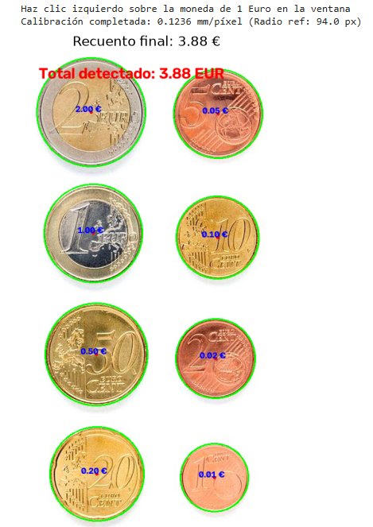
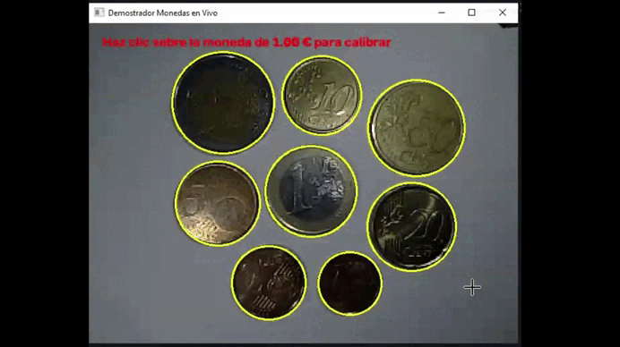
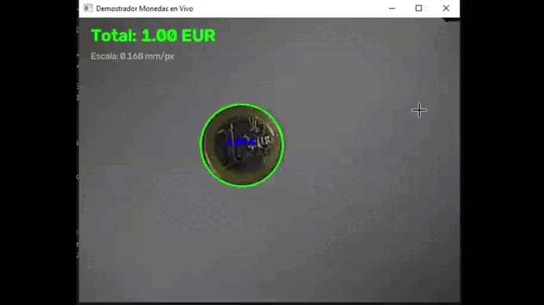
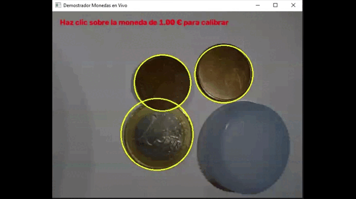
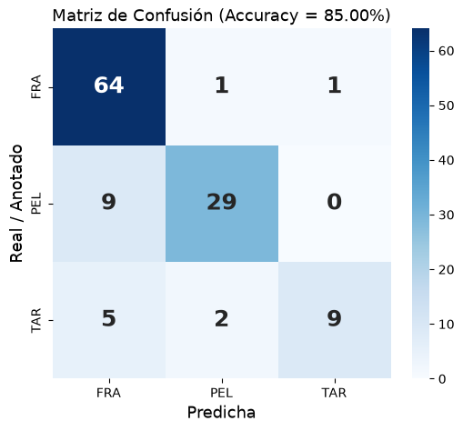

# Práctica 3 VC

Ejercicios de la tercera práctica de laboratorio de VC.

Nicolás Hernández Castro y Gabriel Godoy Navarro - EII ULPGC 20 de octubre de 2026

## Tarea 1: Contar monedas

### Imagen ideal
Inicialmente se va a realizar el conteo de monedas en la imagen ideal proporcionada. En primer lugar, se definen dos diccionarios que asocian cada moneda con su diámetro en milímetros y con su importe decimal en euros. Luego se carga la imagen de partida en formato BGR mediante `cv2.imread('Monedas.jpg')` y se convierte a escala de grises con `cv2.cvtColor`. Para atenuar el ruido de alta frecuencia y los relieves internos sin deformar los bordes exteriores, se aplica un filtro de mediana mediante `cv2.medianBlur(gris, 7)`. Dado que las monedas se encuentran sobre un fondo blanco uniforme, se binariza la imagen con `cv2.threshold(suavizada, 200, 255, cv2.THRESH_BINARY_INV)` para invertir los valores y obtener las monedas en blanco (255) y el fondo en negro (0).

A continuación, se localizan los contornos exteriores con `cv2.findContours(th, cv2.RETR_EXTERNAL, cv2.CHAIN_APPROX_SIMPLE)`. Se descartan posibles imperfecciones mediante un filtro de área mínima (`cv2.contourArea(c) > 500`) y se ajusta cada contorno al círculo mínimo con `cv2.minEnclosingCircle(c)`. Este ajuste calcula el círculo exterior real de cada moneda, almacenando sus centros `(cx, cy)` y sus radios en píxeles.

Para establecer la correspondencia métrica, se implementa una fase de calibración interactiva mediante `cv2.setMouseCallback`, que asocia la función `click_callback` a la ventana de previsualización para registrar las coordenadas `(x, y)` cuando el usuario hace clic izquierdo sobre la moneda conocida de referencia (1 Euro = 23.25 mm). Con la función `np.hypot` se calcula la distancia euclídea del punto de clic al centro de todas las monedas detectadas y se selecciona la más próxima con `np.argmin`. A partir de su radio medido en píxeles, se calcula el factor de conversión métrico (mm por píxel) dividiendo el diámetro teórico entre su diámetro en la imagen.

Finalmente, con esa escala se itera sobre cada círculo detectado calculando su diámetro real estimado en milímetros. Empleando un clasificador por mínima distancia euclídea, se compara este valor frente a una tabla con las dimensiones oficiales en milímetros mediante `min(DIAMETROS_MONEDAS.keys(), key=lambda k: abs(DIAMETROS_MONEDAS[k] - diametro_mm))`. Tras asignar a cada moneda su valor correspondiente, se marca sobre la imagen. 

En el resultado se observa cómo se suma de forma exacta el importe total de las 8 monedas presentes en la imagen (3.88 €):

### Demostrador en vivo

Para el demostrador en vivo, se inicializa la captura de fotogramas mediante `cv2.VideoCapture(0)`. Dentro del bucle continuo, cada fotograma se convierte a escala de grises y se suaviza mediante `cv2.GaussianBlur(gris, (9, 9), 2.0)` para atenuar el ruido electrónico del sensor de la cámara. 

La detección de las monedas en cada fotograma se lleva a cabo mediante la transformada de círculos de Hough con `cv2.HoughCircles(gris_blur, cv2.HOUGH_GRADIENT, dp=1.1, minDist=60, param1=100, param2=48, minRadius=30, maxRadius=110)`. Dado que puede generar falsos positivos en zonas vacías del fondo blanco por coincidencias de gradientes o sombras, se implementa un filtro de contraste interior que para cada círculo detectado genera una máscara binaria circular temporal y calcula la intensidad media de gris en su interior con `cv2.mean(gris, mask=mascara)[0]`. Si la intensidad media supera 210, se descarta por tratarse de papel blanco, conservando únicamente aquellas regiones oscuras correspondientes a metal real.

Para garantizar la estabilidad del recuento en vídeo y evitar el parpadeo constante de etiquetas entre fotogramas, se diseñó un sistema de asociación espacial y filtrado temporal:
* Se compara el centroide de cada detección actual con los centros del fotograma anterior usando `np.hypot(x - cx_ant, y - cy_ant) < 20`. Si la distancia es menor a 20 píxeles, se identifica como la misma moneda física sobre la mesa y se actualiza su posición.
* Para cada moneda se mantiene una cola o búfer deslizante con las mediciones de radio de los últimos 25 fotogramas (`len(m['radios']) > 25`). 
* En lugar de clasificar el radio instantáneo, se calcula la mediana estadística (`np.median(m['radios'])`), lo que neutraliza por completo los picos y oscilaciones aleatorias causados por el ruido de cuantización de la cámara.

Al igual que en la imagen estática, la calibración métrica se realiza haciendo clic izquierdo sobre la moneda de referencia de 1.00 €. Con la escala activa, cada moneda se clasifica por mínima distancia frente a la tabla oficial. Además, para contemplar la posible presencia de objetos que no sean monedas o monedas solapadas, se establece una tolerancia de aceptación física de `2.2 mm` (`abs(diametro_teorico - diametro_mm) < 2.2`). Si el diámetro se encuentra dentro del margen, la moneda se valida, se suma a la cuenta global `total_dinero` y se dibuja en verde `(0, 255, 0)` con su importe; si el objeto difiere en exceso de cualquier valor del catálogo, se marca en color naranja `(0, 165, 255)` como objeto no identificado o solapado. En la parte superior de la imagen se proyectan en tiempo real el valor total acumulado, las instrucciones y la escala de calibración mediante `cv2.putText`, finalizando la ejecución al presionar la tecla ESC.

Para preparar la demostración, se acomodó cuidadosamente el entorno de captura para minimizar sombras y exceso de luz ambiente. Las monedas se colocaron sobre un folio blanco, la cámara se fijó en una posición cenital específica y se dispuso iluminación auxiliar lateral con linternas para eliminar por completo las sombras proyectadas.

En las pruebas se puede observar que cuando las monedas se colocan desde el comienzo y separadas a una distancia parecida, el sistema las detecta y clasifica de forma correcta y estable. En cambio, cuando se añade cada moneda una a una se puede confundir con alguna moneda, aunque acertando la mayoría.

Además, los objetos que no son monedas, como el tapón de plástico, no se detectan al ser descartados automáticamente por el filtro de brillo interior (cv2.mean < 210) y la falta de contraste con el folio. Por otro lado, las monedas parcialmente superpuestas sí se detectan y clasifican. Esto ocurre porque la Transformada de Hough no necesita el contorno cerrado completo, bastándole los arcos visibles de la circunferencia para estimar el radio real dentro del margen de tolerancia de 2.2 mm.

Uso de la IA: Durante la fase de desarrollo surgieron dos dificultades principales, como la detección de círculos falsos sobre áreas vacías del papel blanco y la fluctuación continua de los valores monetarios entre fotogramas. Para resolver estos problemas, se recurrió a la asistencia de una IA y recomendó implementar una comprobación de contraste interno creando una máscara temporal con `cv2.circle` y evaluando la intensidad media con `cv2.mean`, descartando de forma automática regiones que superaran un umbral de 210 de brillo. También recomendó diseñar una estructura de seguimiento por proximidad espacial euclídea (`np.hypot < 20`) combinada con una cola histórica de radios estabilizada mediante la mediana (`np.median`). Esta solución eliminó los saltos de etiquetas causados por el ruido del sensor sin comprometer la fluidez de la captura en vivo.

## Tarea 2: Clasificación de microplásticos

### Preprocesamiento y Segmentación
El objetivo de esta segunda tarea consiste en detectar, extraer y clasificar partículas presentes en imágenes de tres categorías: fragmentos plásticos (FRA), pellets (PEL) y alquitrán (TAR). En primer lugar, se define una función de extracción que procesa cada imagen. Dado que la iluminación de las cámaras o escáneres suele presentar viñeteo o gradientes indeseados, se genera una estimación del fondo de la imagen aplicando un filtro de mediana bastante grande mediante `cv2.medianBlur(img, 51)`. Se realiza el mismo proceso convirtiendo al espacio de color LAB la imagen mediante `cv2.cvtColor`, el cual separa la información de luminosidad de la de cromatismo.

Para aislar las partículas, se calcula un mapa de contraste diferencial absoluto (`cv2.absdiff`) tanto en BGR como en LAB entre la imagen original y su fondo estimado. Se combinan estos resultados dando mayor peso a los canales de color diferencial para destacar objetos que, aunque oscuros, tienen una fuerte firma cromática. Tras aplicar un suavizado gaussiano a este mapa de puntuación, se binariza mediante `cv2.threshold` y se limpia el ruido con una apertura morfológica usando `cv2.morphologyEx`.

A continuación, se extraen los contornos externos con `cv2.findContours`. Sin embargo, es frecuente que múltiples partículas aparezcan unidas o rodeadas de sombras fuertes. Para resolver esto, se implementa una etapa de separación: si un contorno detectado excede ciertas dimensiones o presenta una solidez geométrica baja (`área / área_convex_hull < 0.88`), se aísla su región de interés (ROI) y se recalcula un umbral local basado en el valor máximo de contraste de esa zona. Esto permite separar de forma efectiva trozos de alquitrán o pellets que se tocaban físicamente.

### Extracción de Características
Una vez localizados los contornos limpios de cada partícula, se procede a la extracción de descriptores. Mediante funciones como `cv2.contourArea`, `cv2.arcLength`, `cv2.convexHull` y `cv2.minEnclosingCircle`, se calculan propiedades puramente geométricas invariantes a la escala y rotación:
- **Compacidad y Circularidad**: Relaciones matemáticas entre el área y el perímetro que ayudan a distinguir la redondez perfecta de un pellet frente a los bordes irregulares de un fragmento.
- **Solidez y Extensión**: Proporción del área de la partícula frente a su envolvente convexa y su caja delimitadora (bounding box).
- **Relaciones axiales**: Ajuste de una elipse mediante `cv2.fitEllipse` para calcular el ratio entre su eje mayor y menor.
- **Varianza radial**: Utilizando los momentos espaciales (`cv2.moments`) para hallar el centroide, se calcula la desviación estándar y el ratio min/max de las distancias desde el centro a los bordes.

Adicionalmente, se incorporan descriptores de apariencia y color. Para evitar que los píxeles del borde contaminen la muestra, se genera una máscara binaria de la partícula y se erosiona mediante `cv2.erode`. Sobre esa región interna segura, se extrae la diferencia media de luminosidad y los valores medios de los canales de color puro  en el espacio LAB.

### Entrenamiento del Clasificador
Para la fase de entrenamiento, se cargan mediante `glob` todas las imágenes proporcionadas de fragmentos, pellets y alquitrán (excluyendo la de test). Se procesan por la función de extracción, conformando un conjunto de datos tabular en `pandas`. 

Se emplea un clasificador de bosque de árboles extremadamente aleatorios (`ExtraTreesClassifier` de Scikit-Learn) con 300 estimadores. Se configura con el parámetro `class_weight='balanced'` para compensar posibles diferencias en el número de muestras extraídas de cada categoría durante el ajuste con `modelo.fit()`.

### Predicción y Resultados en Imagen de Test
Para validar el sistema, se extraen los descriptores de las partículas presentes en la imagen no vista `MPs_test.jpg` y se predicen sus etiquetas. Para poder comparar objetivamente las predicciones con la realidad (Ground Truth), se cruzan los resultados con las anotaciones manuales proporcionadas en el archivo `MPs_test_bbs.csv`.

El algoritmo de emparejamiento entre predicciones y anotaciones se realiza en dos fases:
1. **Solapamiento**: Se calcula la Intersección sobre Unión entre las coordenadas de la caja detectada por visión artificial y la caja anotada en el CSV. Si el solapamiento es sustancial, se asignan como la misma partícula.
2. **Distancia Euclidiana**: Debido a que los recuadros humanos en el CSV a veces no encajan perfectamente o están desplazados, si el IoU falla, se emplea `np.hypot` para encontrar la partícula detectada cuyo centroide esté físicamente más cerca del centroide anotado en el CSV.

Finalmente, mediante `sklearn.metrics`, se evalúa el rendimiento del sistema calculando el *Accuracy* (Exactitud) global y la *Precision* ponderada, generando un reporte de clasificación por clases. Para visualizar el desempeño y detectar dónde se confunde el modelo, se representa una Matriz de Confusión utilizando un mapa de calor (`sns.heatmap`), demostrando la robustez de las características geométricas y de color seleccionadas.

**Uso de la IA:** Durante el desarrollo surgieron dos retos principales: separar partículas unidas por sombras y emparejar fiablemente las detecciones con el archivo CSV. Para resolverlo, la IA recomendó aislar las regiones con baja solidez geométrica (`cv2.convexHull < 0.88`) y aplicarles un umbral dinámico local para separar los grumos limpiamente. Para la evaluación, sugirió un emparejamiento en dos fases: validación principal por solapamiento de áreas (IoU) y una alternativa de rescate por distancia mínima entre centroides (`np.hypot`). Esto evitó que imprecisiones en las anotaciones penalizaran las métricas reales del modelo.

